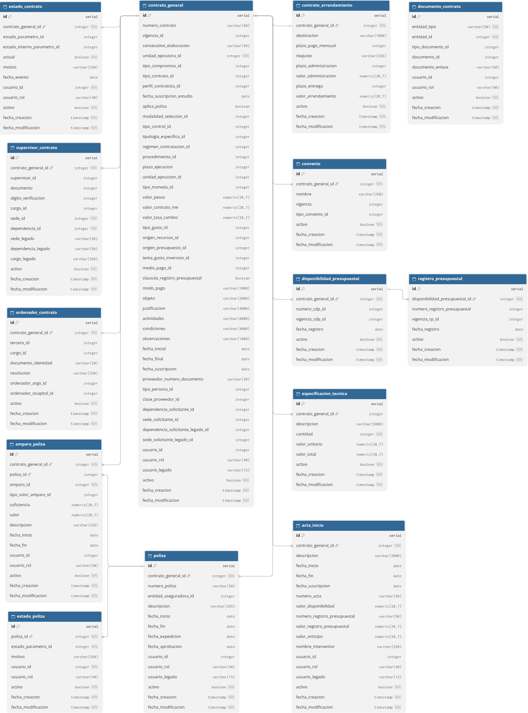

# Modelo de datos ARGO v2 — Modelo final (#384, #389)

## 1. Objeto y alcance

**Objeto.** Modelo de datos de gestión contractual de ARGO v2 del que se genera el CRUD de la #385 (Beego v2, ingeniería inversa desde la base de datos).
- La #384 lo refinó con base en el análisis de las issues #356 y #368 y en las decisiones del LT del 22/10/2026.
- La #389 lo cierra con las decisiones del 26 y 27/10/2026 y con el **modelo final que adjuntó el LT** ([comentario 6452443769](https://github.com/udistrital/argo_documentacion/issues/389#issuecomment-6452443769)).

**Entregables:**

| Archivo | Contenido |
|---|---|
| `modelo-argo-v2.dbml` | Modelo en DBML: fuente de verdad. Es el DBML final del LT, con las notas actualizadas en la #389 |
| `ddl/creacion-tablas.sql` | DDL de la base nueva para la #385 (14 tablas) |
| `diccionario-datos.md` | Diccionario de datos (A13), generado desde el DBML |
| `ddl/migracion-desde-v2.up.sql` y `.down.sql` | **Obsoletos para el modelo final (#389):** migración desde el modelo actual de develop, conservando los datos, y su reverso. Ver `notas-migracion.md` |
| `ddl/carga-inicial-unidad-ejecutora.sql` | **Obsoleto para el modelo final (#389):** carga inicial de las tablas de unidad ejecutora. Ver `notas-migracion.md` |
| `notas-migracion.md` | Notas de migración de la #384, **obsoletas para el modelo final** (sección 8) |
| `scripts/` | Generadores del diccionario y de la carga inicial, sincronizador de comentarios y datos de prueba |
| `evidencias/` | Pruebas y capturas: `01`–`09` de la #384 y `389/` de la #389 |

**Fuera de alcance:**
- Implementar el CRUD (#385).
- Cambiar la estructura del modelo final del LT: tablas, columnas, tipos y relaciones quedan como él los entregó.
- Cambiar datos en Parámetros u otros servicios.
- Los temas en stand by, que quedan como notas en el diagrama (sección 10).

## 2. Fuentes y versiones

| Fuente | Versión |
|---|---|
| Modelo final del LT | Adjunto `argo_v2_modelo_datos.txt` del [comentario 6452443769](https://github.com/udistrital/argo_documentacion/issues/389#issuecomment-6452443769) (27/10/2026), copiado íntegro en el commit `c015bb4` |
| Diagrama final | [dbdiagram.io](https://dbdiagram.io/d/6ad7138cd7bbc90c21d6e18d) ([comentario 6448780824](https://github.com/udistrital/argo_documentacion/issues/389#issuecomment-6448780824)) y su exportación en el [comentario 6453949520](https://github.com/udistrital/argo_documentacion/issues/389#issuecomment-6453949520) |
| Modelo de la #384 | PR #394, rama `feature/384-modelo-datos-v2`, commit `6a10489` |
| `gestion_contractual_crud`, `sql/creacion-tablas.sql` | develop `9e20927` (2026-10-05) |
| Consumidores revisados | `gestion_contractual_mid` develop `133bb75`, `gestion_contractual_mf` develop `f546335` |
| Lineamiento de modelos relacionales | `udistrital/lineamientos_oas`, `modelo_de_datos/lineamientos_modelos_relacionales.md` (master) |

## 3. Decisiones del LT

### 3.1 Del 26 y 27/10/2026 (#389)

Fuentes:
- respuestas del LT por ítem del consolidado: [comentario 6433877493](https://github.com/udistrital/argo_documentacion/issues/389#issuecomment-6433877493);
- decisiones de la reunión del 26/10, publicadas por Ivan: [comentario 6448000059](https://github.com/udistrital/argo_documentacion/issues/389#issuecomment-6448000059);
- modelo conceptual con ajustes de Karen: [comentario 6447478068](https://github.com/udistrital/argo_documentacion/issues/389#issuecomment-6447478068);
- modelo final del LT: [comentario 6452443769](https://github.com/udistrital/argo_documentacion/issues/389#issuecomment-6452443769).

| Ítem | Decisión | Efecto en el modelo |
|---|---|---|
| 19 | "Se remueve la tabla parametro unidad ejecutora" | Sale `parametro_unidad_ejecutora` |
| 35 (A7) | "Agregar tabla de estados a póliza" | Nueva `estado_poliza`; sale `poliza.estado_poliza_id` |
| 82 | `vigencia_id` | `contrato_general.vigencia varchar(4)` pasa a `vigencia_id integer` (Parámetros CRUD); también `vigencia_cdp_id` y `vigencia_rp_id` |
| 78 | Relación polimórfica de los documentos | `documento_contrato.contrato_general_id` pasa a `entidad_tipo` + `entidad_id` (`contrato_general`, `poliza` o `acta_inicio`), sin FK física ni CHECK: valida el CRUD |
| 40 | "No, se va a implementar el nuevo" | La migración y la carga inicial quedan obsoletas (sección 8) |
| 42 | "Se incorpora firma manual, si se integra otro servicio se registra igualmente en documento_contrato" | Nota en `documento_contrato` |
| 47 | "A nivel de modelo no afecta, se debe controlar a nivel de implementación (generación)" | Las columnas de `acta_inicio` se mantienen (S2) |
| 10 | Estado visible y máquina de estados interna (#384, 24/10) | Notas en `estado_contrato` |
| 2 | No incluir `lugar_ejecucion` (#384, 22/10) | El modelo final no absorbe sus columnas en `contrato_general` |
| Solicitante | Absorbido en el modelo final | `dependencia_solicitante_id`, `sede_solicitante_id` y sus `_legado_id` en `contrato_general`; sale `solicitante` |
| 28, 29, 34, 36, 37, 41, 43, 44, 46, 49 | De implementación o de otros módulos | Sin efecto en el modelo |

### 3.2 Del 22/10/2026 (#384)

Comentario "Validación con el equipo": https://github.com/udistrital/argo_documentacion/issues/384#issuecomment-6347875572. Siguen vigentes:
- A6: `fecha_suscripcion` en `contrato_general`;
- A13: diccionario;
- A14: `UNIQUE (numero_contrato, vigencia)`, que hoy es `uq_numero_contrato_vigencia_id_contrato_general`;
- `usuario_id` y `usuario_rol` en las tablas de negocio;
- ítems 15 y 16: proveedor absorbido en `contrato_general`.

## 4. Supuestos

| # | Tema | Estado en el modelo final |
|---|---|---|
| S1 | Régimen de contratación y tema de gasto de inversión se mantienen, nullable | Pendiente (ítem 23: "Validar integración y compatibilidad") |
| S2 | Columnas nuevas de `acta_inicio` | Se mantienen: el LT indicó que no afecta el modelo (ítem 47) |
| S3 | Base `administrativa` y esquema `contratacion` | Pendiente (ítem 51) |
| S4 | Tablas de unidad ejecutora y códigos 01/02 | Obsoleto: las dos tablas no están en el modelo final; los códigos quedan en "Validación paramétrica" (ítems 80 y 146) |
| S5 | `poliza.estado_poliza_id` | Reemplazado por `estado_poliza` (ítem 35) |
| S6 | `documento_contrato` "con ajustes" | Resuelto: relación polimórfica (ítem 78) |
| S7 | `lugar_ejecucion` absorbida | Resuelto: sus columnas no están en el modelo final (ítem 2) |
| S8 | `huella_navegador` | No está en el modelo final; pendiente de confirmar con el LT (sección 10) |

## 5. Modelo

- **dbdiagram.io:** [ARGO v2 — Modelo de datos](https://dbdiagram.io/d/6ad7138cd7bbc90c21d6e18d). Es el diagrama del modelo final; se abre sin sesión (`evidencias/389/09-dbdiagram-incognito.png`). El editor de ese diagrama tiene el DBML del LT con sus notas originales; las notas actualizadas están en `modelo-argo-v2.dbml`.
- **Imagen:** `evidencias/389/10-modelo-final-dbdiagram.png`, exportación del diagrama final publicada en el [comentario 6453949520](https://github.com/udistrital/argo_documentacion/issues/389#issuecomment-6453949520).



**14 tablas, 199 columnas, 13 FK, 2 UNIQUE y 16 índices, en 4 dominios:**

| Dominio | Tablas |
|---|---|
| Contrato | `contrato_general`, `estado_contrato`, `supervisor_contrato`, `ordenador_contrato`, `contrato_arrendamiento` (1 a 1), `convenio`, `especificacion_tecnica` |
| Presupuesto | `disponibilidad_presupuestal`, `registro_presupuestal` |
| Póliza y amparos | `poliza`, `amparo_poliza`, `estado_poliza` |
| Documentos y actas | `documento_contrato` (polimórfica), `acta_inicio` |

**Reglas comunes:**
- Toda tabla tiene `id serial` (`pk_<tabla>`), `activo boolean NOT NULL DEFAULT true`, `fecha_creacion` y `fecha_modificacion timestamp NOT NULL DEFAULT now()`, y `COMMENT ON TABLE`.
- Las referencias a Parámetros CRUD, Terceros, OIKOS, SiCapital y Gestor Documental son `integer` sin FK física, con un comentario que dice a qué apuntan.
- `documento_contrato` no tiene FK física: `entidad_tipo` dice a qué tabla pertenece el documento y `entidad_id` a qué registro. La BD no restringe ninguno de los dos (`evidencias/389/05-entidad-tipo-invalido.txt`).
- Cada FK tiene índice.

## 6. Cambios frente al modelo del PR #394

### 6.1 Tablas

| Cambio | Tablas |
|---|---|
| Se absorbe en `contrato_general` | `solicitante` |
| Salen del modelo | `parametro_unidad_ejecutora` (ítem 19), `configuracion_unidad_ejecutora` y `huella_navegador` (las dos últimas, pendientes de confirmar con el LT) |
| Nueva | `estado_poliza` (ítem 35) |
| Sin cambios de columnas | `estado_contrato`, `supervisor_contrato`, `ordenador_contrato`, `contrato_arrendamiento`, `convenio`, `especificacion_tecnica`, `amparo_poliza`, `acta_inicio` |

### 6.2 Columnas

| Tabla | Antes (PR #394) | Modelo final |
|---|---|---|
| `contrato_general` | `vigencia varchar(4)` | `vigencia_id integer` (Parámetros CRUD) |
| `contrato_general` | `lugar_ejecucion_pais_id`, `_ciudad_id`, `_municipio_id`, `_dependencia_id`, `_sede_id`, `_direccion` | Retiradas |
| `contrato_general` | — (en `solicitante`: `dependencia_id`, `sede_id`) | `dependencia_solicitante_id`, `sede_solicitante_id`, `dependencia_solicitante_legado_id`, `sede_solicitante_legado_id`, nullable |
| `disponibilidad_presupuestal` | `vigencia_cdp` | `vigencia_cdp_id` |
| `registro_presupuestal` | `vigencia_rp` | `vigencia_rp_id` |
| `poliza` | `estado_poliza_id` | Retirada; el estado pasa a `estado_poliza` |
| `documento_contrato` | `contrato_general_id` (FK) | `entidad_tipo varchar(50)` + `entidad_id integer`, sin FK |

### 6.3 Restricciones e índices

| Antes (PR #394) | Modelo final |
|---|---|
| `uq_numero_contrato_vigencia_contrato_general` | `uq_numero_contrato_vigencia_id_contrato_general` |
| `fk_documento_contrato_contrato_general` e `idx_documento_contrato_contrato_general_id` | `idx_documento_contrato_entidad_tipo_entidad_id` (sin FK) |
| `fk_solicitante_contrato_general`, `idx_solicitante_contrato_general_id` | Salen con la tabla |
| — | `fk_estado_poliza_poliza`, `idx_estado_poliza_poliza_id` |

## 7. DDL y lineamientos

`ddl/creacion-tablas.sql` implementa el DBML final:
- **Esquema y base:** esquema `contratacion` y base `administrativa`, provisionales (S3). El esquema se cambia en la línea `SET search_path`, y el bloque `DO` lo crea.
- **Restricciones:** `CONSTRAINT pk_<tabla>`, `fk_<origen>_<referenciada>` y `uq_<col>_<tabla>` dentro de cada `CREATE TABLE`, e índices `idx_<tabla>_<campo>`, con los mismos nombres del DBML.
- **Comentarios:** `COMMENT ON TABLE` y `COMMENT ON COLUMN` tomados de las notas del DBML.
- **Sin CHECK:** el modelo no tiene `ck_`. La polimórfica de `documento_contrato` va sin FK ni CHECK, por decisión del LT.

La consulta de lineamientos de la #384 no encuentra incumplimientos sobre el catálogo (sección 9).

## 8. Migración y carga inicial (obsoletas)

`ddl/migracion-desde-v2.up.sql`, `ddl/migracion-desde-v2.down.sql` y `ddl/carga-inicial-unidad-ejecutora.sql` se conservan como referencia, pero **no aplican al modelo final**:
- **Migración:** el LT respondió al ítem 40 "No, se va a implementar el nuevo", y la #385 crea la base desde `ddl/creacion-tablas.sql`. Además, la migración se escribió para el modelo del PR #394 (crea tablas que el modelo final no tiene y no contempla `estado_poliza`, `vigencia_id` ni la polimórfica).
- **Carga inicial:** el LT retiró `parametro_unidad_ejecutora`, y `configuracion_unidad_ejecutora` no está en el modelo final.
- **Pregunta abierta para el LT:** ¿se confirma que no hay migración de datos hacia el modelo final, ni desde el modelo actual de `gestion_contractual_crud` ni desde ARGO v1? Si la hay, la migración se rehace sobre el modelo final.

`notas-migracion.md` tiene el mismo aviso al inicio.

## 9. Pruebas y evidencias (#389)

PostgreSQL 16.13 en el contenedor `postgres:16-alpine` (`pg384`), sobre una base de prueba que se crea y se borra en cada corrida. Las pruebas d), e) y f) corren dentro de una transacción con `ROLLBACK`. Cada evidencia tiene su `.txt` (salida completa) y su `.png`.

| Prueba | Resultado | Evidencia |
|---|---|---|
| a) BD limpia con `ddl/creacion-tablas.sql` | Sin errores: 14 tablas en el esquema `contratacion` | `evidencias/389/01-ddl-bd-limpia` |
| b) Lineamientos sobre el catálogo | 12 controles sin incumplimientos | `evidencias/389/02-lineamientos` |
| c) DDL frente a `dbml2sql` (@dbml/cli 3.14.1) del mismo DBML | 0 diferencias en 471 líneas (199 columnas, 27 PK y FK, 32 índices y los comentarios de 14 tablas y 199 columnas). Diferencias esperadas, normalizadas: nombre de la PK, UNIQUE como índice único y prefijo de esquema | `evidencias/389/03-ddl-vs-dbml2sql` |
| d) `numero_contrato` duplicado en la misma vigencia | Rechazado por `uq_numero_contrato_vigencia_id_contrato_general`; en otra vigencia se acepta | `evidencias/389/04-unique-numero-contrato` |
| e) `entidad_tipo` inválido en `documento_contrato` | **Aceptado por la BD**, igual que un `entidad_id` inexistente: lo debe validar el CRUD de la #385 | `evidencias/389/05-entidad-tipo-invalido` |
| f) Borrado lógico | `UPDATE activo = false`: la fila sigue en la tabla y un listado de activos no la devuelve | `evidencias/389/06-borrado-logico` |
| Diff de las notas del DBML | Solo cambian notas; el SQL de `dbml2sql` antes y después difiere únicamente en los `COMMENT ON` | `evidencias/389/07-diff-notas-dbml` |
| Diccionario renderizado | 14 tablas, 199 columnas | `evidencias/389/08-diccionario-renderizado.png` |
| Diagrama sin sesión | Se abre en una ventana de incógnito de Chrome | `evidencias/389/09-dbdiagram-incognito.png` |

Las evidencias `01`–`09` de la raíz de `evidencias/` son de la #384 y corresponden al modelo del PR #394.

## 10. Pendientes con el LT y la Analista

| Tema | Pendiente | Responsable |
|---|---|---|
| `huella_navegador` | No está en el modelo final. Se había definido con `metadatos` jsonb y columnas generadas (#384, 24/10). ¿Sale del modelo v2? | LT |
| `configuracion_unidad_ejecutora` | No está en el modelo final, aunque el comentario 6448000059 dice que se mantiene | LT |
| `documento_contrato` | ¿Lleva `metadatos` jsonb, que estaba en los dos diagramas? ¿El nombre final es `documento_contrato` o `documento`? | LT |
| Ítem 8 | ¿Se agrega UNIQUE a `consecutivo_elaboracion`? Hoy el modelo no lo tiene | LT |
| Ítem 13 | "Se debe unificar": ¿es la absorción de `solicitante` en `contrato_general`? | LT |
| Ítem 18 | ¿Se conserva `supervisor_contrato.digito_verificacion`? | LT |
| Migración | ¿Se confirma que no hay migración de datos (ítem 40)? | LT |
| PR #394 | ¿Se cierra, dado que este modelo lo reemplaza? | LT |
| `vigencia_cdp_id`, `vigencia_rp_id` | Tienen sufijo `_id` y su nota dice "Año de vigencia": ¿son referencias a Parámetros o el año? | LT |
| A8, A11, A12 | Estudio previo (Ágora), proyecto de extensión y ordenadores múltiples | Analista |
| S1, S3 | Régimen y tema de gasto (ítem 23); base y esquema (ítem 51) | LT |
| Parámetros | Validación paramétrica (ítems 80, 146, 7, 30, 31, 32, 33 y 45) y estados de la póliza | LT / Analista |

## 11. Impacto en la #385

- **Generación:** el CRUD se genera con `bee generate appcode` desde una base creada con `ddl/creacion-tablas.sql`. Los ajustes sobre lo generado que se identificaron en la #384 siguen aplicando: `;auto` en la PK, tipos nulos, tipo con precisión para `numeric(20,7)` y `rel(one)` en `contrato_arrendamiento`.
- **Borrado lógico:** el DELETE debe ser lógico (`activo = false`). Hoy 7 servicios del CRUD NestJS borran físico (`cdp`, `contratista`, `documento-contrato`, `estado-contrato`, `lugar-ejecucion`, `solicitante` y `supervisor`).
- **Polimórfica:** el CRUD valida que `entidad_tipo` sea `contrato_general`, `poliza` o `acta_inicio` y que exista `entidad_id`, y desactiva los documentos cuando se desactiva su registro.
- **Consumidores:** el MF envía hoy `contrato_general_id` a `documentos-contratos` en `polizas.service.ts` (`getActaGuardada` y `registrarDocumentoActa`) y en `contrato-general-crud.service.ts`; debe pasar a `entidad_tipo` y `entidad_id`. Lo mismo aplica a los consumidores de `contratistas`, `lugares-ejecucion` y `solicitantes`, que ya no existen como tablas.
- **Conexión:** la base y el esquema son provisionales (S3); la conexión debe usar el `search_path` del esquema.

## Regenerar

```bash
# Diccionario de datos
npm install --prefix /tmp/dbml @dbml/core@3
NODE_PATH=/tmp/dbml/node_modules node scripts/genera_diccionario.js
```
