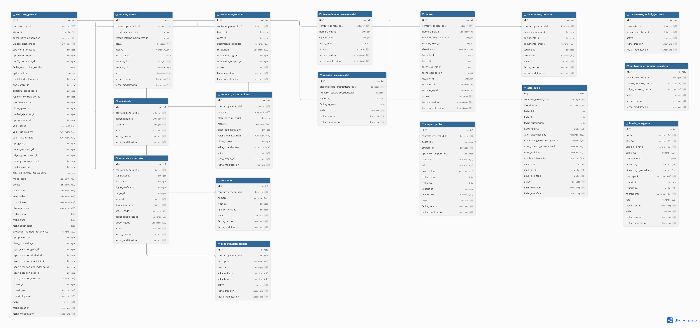

# Modelo de datos ARGO v2 refinado — Issue #384

## 1. Objeto y alcance

**Objeto.** Revisar y ajustar el modelo de datos de gestión contractual de ARGO v2 con base en el análisis de las issues #356 y #368 y en las decisiones del LT del 22/10/2026. El resultado es el modelo del que se genera el CRUD de la #385 (Beego v2, ingeniería inversa desde la base de datos).

**Entregables:**

| Archivo | Contenido |
|---|---|
| `modelo-argo-v2.dbml` | Modelo en DBML: fuente de verdad, publicada en [dbdiagram.io](https://dbdiagram.io/d/6adb8b82aac330141004baa1) |
| `ddl/creacion-tablas.sql` | DDL de la base nueva para la #385 |
| `ddl/migracion-desde-v2.up.sql` y `.down.sql` | Migración desde el modelo actual de develop, conservando los datos, y su reverso |
| `ddl/carga-inicial-unidad-ejecutora.sql` | Carga inicial de las tablas de unidad ejecutora |
| `notas-migracion.md` | Orden de ejecución, requisitos, mapeo de ARGO v1, ajuste de códigos en Parámetros, carga inicial e impacto en consumidores |
| `diccionario-datos.md` | Diccionario de datos (A13), generado desde el DBML |
| `scripts/` | Generadores del diccionario y de la carga inicial, sincronizador de comentarios y datos de prueba |
| `evidencias/` | Salidas de las pruebas y capturas |

**Fuera de alcance:**
- Implementar el CRUD (#385).
- Cambiar datos en Parámetros u otros servicios.
- Los temas en stand by, que quedan como notas en el diagrama (sección 10).

## 2. Fuentes y versiones

| Fuente | Versión |
|---|---|
| `gestion_contractual_crud`, `sql/creacion-tablas.sql` | develop `9e20927` (2026-10-05) |
| `huella_navegador` (#376) | PR gestion_contractual_crud#49, commit `0198621` (sin mergear) |
| Análisis de la #356 (`gestion-contractual/analisis-modelo-datos/`) | main `b396fd1` |
| Columnas nuevas de `acta_inicio` (#359) | `minuta_contractual_mid`, rama `feature/359-actualizar-integrar-actas-inicio` (PR #13, sin mergear) |
| Consumidores revisados | `gestion_contractual_mid` develop `133bb75`, `gestion_contractual_mf` develop `f546335`, `poliza_mid` `a47b471` |
| Consolidado de parámetros depurado por negocio | Adjunto de la #384 (`consolidado_parametros_argo_v2_2026-10-13 (1).xlsx`) |
| Modelo de ARGO v1 | Diagrama compartido por el LT en la #356 (28/09/2026) |
| Lineamiento de modelos relacionales | `udistrital/lineamientos_oas`, `modelo_de_datos/lineamientos_modelos_relacionales.md` (master) |

## 3. Decisiones del LT

Comentario "Validación con el equipo" del 22/10/2026: https://github.com/udistrital/argo_documentacion/issues/384#issuecomment-6347875572

| Tema | Decisión |
|---|---|
| A1–A5 | No aplican por implementación nueva. El modelo nuevo cumple los lineamientos desde el inicio |
| A6, ítem 9 | Agregar `fecha_suscripcion` en `contrato_general` |
| A7 | La póliza sí tiene estado; los estados están pendientes de definir |
| A8 | Stand by, pendiente de validación con Ágora |
| A9 | Documentos en una sola tabla, sin estados, "con ajustes" |
| A10 | Novedades y terminación van en una etapa posterior |
| A11 | Validar si el proyecto de extensión va en un campo actual o es un selector nuevo exclusivo de IDEXUD |
| A12 | Stand by. Contratista 1 a 1; confirmar si el ordenador puede ser múltiple; validar si el solicitante es 1 a 1 |
| A13 | Sí: completar el diccionario |
| A14, ítem 7 | Sí: `UNIQUE (numero_contrato, vigencia)`. El número viene migrado de ARGO v1 y se genera con la RN de generación al pasar a SUSCRITO; antes solo existe el consecutivo de elaboración |
| Observación general | Agregar `usuario_id` y `usuario_rol` en `contrato_general`, `poliza`, `amparo_poliza`, `estado_contrato`, `acta_inicio` y `documento_contrato` |
| Ítem 2 | Incluir todas las tablas excepto `lugar_ejecucion`; `ordenador_contrato` con la nota "validar soporte migración ARGO v1" |
| Ítem 15 | `contratista` pasa a `proveedor` |
| Ítem 16 | Por ser 1 a 1, los campos van en `contrato_general`: `proveedor_numero_documento`, `tipo_persona_id`, `clase_proveedor_id` |
| Ítem 19 | "Ajuste registros a: Rectoría 01, IDEXUD 02". Agrupar selectores por unidad ejecutora si aplica (Analista) |

## 4. Trazabilidad

| Decisión o ítem del consolidado | Cambio en el modelo | Archivo |
|---|---|---|
| A1–A5 (no aplican) | PK `id serial`, borrado lógico con `activo`, montos `numeric(20,7)`, varchar con longitud, nombres de restricciones según lineamiento; `registro_presupuestal` incluida (ítem 2) | `modelo-argo-v2.dbml`, `ddl/creacion-tablas.sql`, `evidencias/02-lineamientos-bd-limpia.txt` |
| A6, ítem 9 | `contrato_general.fecha_suscripcion date` nullable. No existe `fecha_firma` | DBML, DDL, migración |
| A7 | `poliza.estado_poliza_id` nullable sin catálogo (S5) y nota en el diagrama | DBML, DDL, migración |
| A8 | Nota en el diagrama; no se modela | DBML |
| A9 | `documento_contrato` sin estados, con `usuario_id` y `usuario_rol` (S6) | DBML, DDL, migración |
| A10 | Fuera del modelo | — |
| A11 | Nota en el diagrama; no se modela | DBML |
| A12 | Nota en el diagrama; no se crean UNIQUE en `contrato_general_id` | DBML |
| A13 | Diccionario generado desde el DBML | `diccionario-datos.md`, `scripts/genera_diccionario.js` |
| A14, ítem 7 | `uq_numero_contrato_vigencia_contrato_general`; `numero_contrato` nullable hasta la suscripción; la migración aborta si hay duplicados | DBML, DDL, `migracion-desde-v2.up.sql`, `evidencias/05-verificaciones-abortan.txt` |
| Observación general | `usuario_id integer` y `usuario_rol varchar(40)` en las 6 tablas (mismo tipo que ya tenían `estado_contrato` y `poliza`) | DBML, DDL, migración |
| Ítem 2 | 14 de las 16 tablas del DDL actual (sin `lugar_ejecucion` ni `contratista`, absorbidas), más 3 nuevas; nota en `ordenador_contrato` | DBML, DDL |
| Ítems 15 y 16 | `contratista` se elimina; sus datos pasan a `contrato_general.proveedor_numero_documento`, `tipo_persona_id` y `clase_proveedor_id`. No tenía otras columnas de negocio | DBML, DDL, migración |
| Ítem 19 | `parametro_unidad_ejecutora`, `configuracion_unidad_ejecutora`, `NOT NULL` e índice en `contrato_general.unidad_ejecutora_id` (S4); códigos 01/02 en Parámetros como ajuste de datos | DBML, DDL, migración, `notas-migracion.md` §6 y §7, `ddl/carga-inicial-unidad-ejecutora.sql` |
| Ítem 23 | Se mantienen `regimen_contratacion_id` y `tema_gasto_inversion_id` (S1) | DBML, DDL |
| Ítem 47 | 7 columnas nuevas en `acta_inicio` (S2) | DBML, DDL, migración |
| Ítem 51 | Esquema `contratacion` y base `administrativa`, provisionales (S3) | DDL, `notas-migracion.md` |
| #376 | `huella_navegador` (S8) | DBML, DDL, migración |

## 5. Supuestos (pendientes de confirmar)

| # | Tema | Supuesto aplicado |
|---|---|---|
| S1 | Ítem 23 | `regimen_contratacion_id` (116) y `tema_gasto_inversion_id` (126) se mantienen, nullable, aunque negocio propuso retirarlos |
| S2 | Ítem 47 | Las 7 columnas de `acta_inicio` de la #359 se incluyen, nullable: `fecha_suscripcion date`, `numero_acta varchar(50)`, `valor_disponibilidad numeric(20,7)`, `numero_registro_presupuestal varchar(50)`, `valor_registro_presupuestal numeric(20,7)`, `valor_anticipo numeric(20,7)`, `nombre_interventor varchar(250)`. El MID las envía sin longitudes, así que las longitudes son provisionales. Los datos de CDP y RP duplican `disponibilidad_presupuestal` y `registro_presupuestal`, y `acta_inicio.fecha_suscripcion` es la fecha del acta, no la del contrato |
| S3 | Ítem 51 | Base `administrativa` y esquema `contratacion`, provisionales. El DDL fija el esquema en una sola línea (`SET search_path TO contratacion;`); el bloque `DO` crea ese esquema |
| S4 | Ítem 19 | Se incluyen las dos tablas de la propuesta del 21/10 tal como están publicadas, más `NOT NULL` e índice en `contrato_general.unidad_ejecutora_id`. "Rectoría 01, IDEXUD 02" se interpreta como el `codigo_abreviacion` de los parámetros 6818 y 6819 (ajuste de datos en Parámetros, no de esquema) |
| S5 | A7 | `poliza.estado_poliza_id integer` nullable, referencia a Parámetros sin FK física, con la nota "estados por definir con la Analista" |
| S6 | A9 | `documento_contrato` sigue siendo una sola tabla sin estados; el ajuste aplicado son `usuario_id` y `usuario_rol`. Falta el detalle de "con ajustes" |
| S7 | `lugar_ejecucion` | La tabla se elimina y sus columnas pasan nullable a `contrato_general` con prefijo `lugar_ejecucion_`, con la nota "pendiente validar depuración de datos contra resoluciones en producción (Analista)" |
| S8 | #376 | Se incluye `huella_navegador` como está en el PR gestion_contractual_crud#49, con un ajuste: `fecha_modificacion` pasa a `NOT NULL` para cumplir el lineamiento |

**Otras decisiones de este análisis, también por confirmar:**
- **Longitudes nuevas.** Las columnas que en develop eran varchar sin longitud quedan así: `modo_pago` 1000, `objeto` 2000, `justificacion` 4000, `actividades` 8000, `condiciones` 4000, `descripcion` 2000 (`especificacion_tecnica` y `acta_inicio`), `destinacion` 1000, `cargo_legado` 250, `resolucion` 250 y `documento_identidad` 20. La migración aborta si algún dato las supera.
- **Renombres por lineamiento:**
  - `solicitante.dependencia_solicitante_id` → `dependencia_id` y `sede_solicitante_id` → `sede_id`;
  - `registro_presupuestal.cdp_id` → `disponibilidad_presupuestal_id`;
  - `registro_presupuestal.registro_presupuestal` → `numero_registro_presupuestal`.
- **`valor_tasa_cambio`** pasa de `numeric(16,10)` a `numeric(20,7)`. La migración aborta si se perdieran decimales.

## 6. Modelo

- **dbdiagram.io:** [ARGO v2 — Modelo de datos (#384)](https://dbdiagram.io/d/6adb8b82aac330141004baa1), enlace público de solo lectura. Contiene el mismo `modelo-argo-v2.dbml` y las tablas están ordenadas por dominio (TableGroup). En el plan gratuito, dbdiagram no dibuja los marcos de los TableGroup ni las notas adhesivas: los grupos se ven como columnas y las notas siguen en el DBML (sección 10).
- **Imagen:** `evidencias/08-modelo-dbdiagram.png`, exportada desde dbdiagram.io. `evidencias/08-modelo-dbdiagram.pdf` es la misma imagen en PDF, generada localmente porque la exportación a PDF de dbdiagram no se completó. `evidencias/09-dbdiagram-abierto.png` es el diagrama abierto en dbdiagram.io.



**17 tablas, 14 relaciones, 6 dominios:**

| Dominio | Tablas |
|---|---|
| Contrato | `contrato_general`, `estado_contrato`, `solicitante`, `supervisor_contrato`, `ordenador_contrato`, `contrato_arrendamiento` (1 a 1), `convenio`, `especificacion_tecnica` |
| Presupuesto | `disponibilidad_presupuestal`, `registro_presupuestal` |
| Póliza y amparos | `poliza`, `amparo_poliza` |
| Documentos y actas | `documento_contrato`, `acta_inicio` |
| Unidad ejecutora | `parametro_unidad_ejecutora`, `configuracion_unidad_ejecutora` |
| Auditoría | `huella_navegador` |

**Reglas comunes:**
- Toda tabla tiene `id serial` (`pk_<tabla>`), `activo boolean NOT NULL DEFAULT true`, `fecha_creacion` y `fecha_modificacion timestamp NOT NULL DEFAULT now()`, y `COMMENT ON TABLE`.
- Las referencias a Parámetros CRUD, Terceros, OIKOS, SiCapital y Gestor Documental son `integer` sin FK física, con un comentario que dice a qué apuntan (y el tipo de parámetro cuando se conoce).
- Cada FK tiene índice. Ningún identificador supera 63 caracteres (el más largo tiene 62).

## 7. Cambios frente al modelo actual (develop 9e20927)

### 7.1 Tablas

| Cambio | Tablas |
|---|---|
| Eliminadas y absorbidas en `contrato_general` | `contratista` (ítems 15 y 16), `lugar_ejecucion` (S7) |
| Nuevas | `parametro_unidad_ejecutora`, `configuracion_unidad_ejecutora` (S4), `huella_navegador` (S8) |
| Sin cambio de columnas, solo restricciones y auditoría | `estado_contrato`, `convenio` |

### 7.2 Columnas por tabla

| Tabla | Nuevas | Renombradas | Cambio de tipo o nulabilidad |
|---|---|---|---|
| `contrato_general` | `fecha_suscripcion`, `proveedor_numero_documento`, `tipo_persona_id`, `clase_proveedor_id`, `lugar_ejecucion_pais_id`, `lugar_ejecucion_ciudad_id`, `lugar_ejecucion_municipio_id`, `lugar_ejecucion_dependencia_id`, `lugar_ejecucion_sede_id`, `lugar_ejecucion_direccion`, `usuario_id`, `usuario_rol` | — | `valor_pesos`, `valor_contrato_me` y `valor_tasa_cambio` a `numeric(20,7)`; `modo_pago`, `objeto`, `justificacion`, `actividades` y `condiciones` con longitud; `unidad_ejecutora_id` NOT NULL |
| `solicitante` | — | `dependencia_solicitante_id` → `dependencia_id`, `sede_solicitante_id` → `sede_id` | `fecha_modificacion` NOT NULL |
| `supervisor_contrato` | — | — | `cargo_legado varchar(250)`; `fecha_modificacion` NOT NULL |
| `ordenador_contrato` | — | — | `resolucion varchar(250)`, `documento_identidad varchar(20)`; `fecha_modificacion` NOT NULL |
| `contrato_arrendamiento` | — | — | `destinacion varchar(1000)`; montos a `numeric(20,7)` |
| `especificacion_tecnica` | — | — | `descripcion varchar(2000)`; montos a `numeric(20,7)` |
| `disponibilidad_presupuestal` | — | — | `activo` NOT NULL |
| `registro_presupuestal` | — | `cdp_id` → `disponibilidad_presupuestal_id`, `registro_presupuestal` → `numero_registro_presupuestal` | — |
| `poliza` | `estado_poliza_id`, `usuario_rol` | — | — |
| `amparo_poliza` | `usuario_id`, `usuario_rol` | — | — |
| `documento_contrato` | `usuario_id`, `usuario_rol` | — | — |
| `acta_inicio` | `fecha_suscripcion`, `numero_acta`, `valor_disponibilidad`, `numero_registro_presupuestal`, `valor_registro_presupuestal`, `valor_anticipo`, `nombre_interventor`, `usuario_rol` | — | `descripcion varchar(2000)` |

**En todas las tablas:**
- `activo` con `DEFAULT true`, fechas con `DEFAULT now()`.
- Restricciones e índices renombrados a `pk_`, `fk_`, `uq_` e `idx_<tabla>_<campo>`.
- Índices nuevos en las FK que no los tenían.
- `UNIQUE (numero_contrato, vigencia)` en `contrato_general`.

No se elimina ninguna columna de negocio: las de `contratista` y `lugar_ejecucion` pasan a `contrato_general`.

## 8. Migración

Ver `notas-migracion.md`, que incluye:
- el orden de ejecución y los requisitos;
- las verificaciones que abortan;
- el mapeo de ARGO v1 (`numero_contrato`, `ordenador_contrato` y otros), sin scripts;
- el ajuste de códigos 01/02 en Parámetros;
- la carga inicial de unidad ejecutora (IDEXUD: 75 parámetros; Rectoría, pendiente de la #383; unidad 03, pendiente);
- el impacto en el MID, el MF y `poliza_mid`, tabla por tabla.

## 9. Pruebas y evidencias

PostgreSQL 16.13 en contenedor `postgres:16-alpine`.

| Prueba | Resultado | Evidencia |
|---|---|---|
| a) BD limpia con `ddl/creacion-tablas.sql` | Sin errores: 17 tablas en el esquema `contratacion` | `evidencias/01-ddl-bd-limpia.txt` (`\dn`, `\dt`, `\d+` de `contrato_general`, `acta_inicio` y `parametro_unidad_ejecutora`) y `.png` |
| a) Lineamientos sobre el catálogo | 12 controles sin incumplimientos | `evidencias/02-lineamientos-bd-limpia.txt` y `.png` |
| DDL frente a `dbml2sql` (@dbml/cli 3.14.1) | 0 diferencias en 229 columnas, 14 FK, 21 únicos (17 PK y 4 UNIQUE), 19 índices y los comentarios de tablas y columnas. Se corrigió en el DBML la dirección de la FK 1 a 1 | `evidencias/03-ddl-vs-dbml2sql.txt` y `.png` |
| b) Migración up sobre el DDL de develop con datos de prueba | Datos de `contratista` y `lugar_ejecucion` en `contrato_general`; esquema resultante igual al de la BD limpia (0 diferencias) | `evidencias/04-migracion-up-down.txt` y `.png` |
| b) Migración down | `pg_dump --schema-only` idéntico al original (solo cambia el token aleatorio de `\restrict`); datos de `contratista` y `lugar_ejecucion` restaurados | `evidencias/04-migracion-up-down.txt` |
| c) Verificaciones del up | Abortan con mensaje y sin cambios en 4 casos: duplicado de A14, unidad ejecutora nula, dos contratistas por contrato y texto largo | `evidencias/05-verificaciones-abortan.txt` y `.png` |
| Carga inicial de unidad ejecutora | 2 configuraciones y 75 parámetros de IDEXUD | `evidencias/06-carga-inicial-unidad-ejecutora.txt` |
| d) Humo para la #385 con `bee generate appcode` (Go 1.27.3, bee v2, beego v2.1.0) | 17 modelos, 17 controladores y 17 namespaces; `go build` sin errores. El código generado no se versiona | `evidencias/07-bee-generate-appcode.txt` y `.png` |

## 10. Pendientes con la Analista y el LT

| Tema | Pendiente | Responsable según la fuente |
|---|---|---|
| A7 | Definir los estados de la póliza (catálogo para `estado_poliza_id`) | Analista |
| A8 | Campos del estudio previo y del proceso, pendientes de la integración con Ágora | Analista / LT |
| A11 | Proyecto de extensión: campo actual o selector nuevo exclusivo de IDEXUD | Analista |
| A12 | Confirmar si un contrato puede tener varios ordenadores y si el solicitante es 1 a 1 | Analista |
| Lugar de ejecución | Validar la depuración de datos contra resoluciones en producción (S7) | Analista |
| Ítem 23 | Confirmar que régimen de contratación y tema de gasto de inversión se mantienen (S1) | LT |
| Ítem 47 | Confirmar las columnas nuevas de `acta_inicio` y sus longitudes (S2) | LT |
| Ítem 51 | Confirmar la base y el esquema definitivos (S3) | LT |
| Ítem 19 | Confirmar la interpretación de "Rectoría 01, IDEXUD 02" y el visto bueno de las dos tablas (S4) | LT |
| A9 | Detalle de "con ajustes" (S6) | LT |
| ARGO v1 | Validar el soporte de migración de `ordenador_contrato` y el mapeo de `notas-migracion.md` §5 | LT |
| Tipo de `vigencia` | `contrato_general.vigencia` es `varchar(4)`, mientras que `disponibilidad_presupuestal.vigencia_cdp` y `registro_presupuestal.vigencia_rp` son `integer`. `vigencia` forma parte del `UNIQUE (numero_contrato, vigencia)` | LT |
| Tipo de `numero_registro_presupuestal` | Es `integer` en `registro_presupuestal` y `varchar(50)` en `acta_inicio` | LT |

## 11. Impacto en la #385

- **Generación.** El CRUD se genera con `bee generate appcode` desde una base creada con `ddl/creacion-tablas.sql`. La prueba de humo generó un modelo y un controlador por cada una de las 17 tablas y compila.
- **Ajustes sobre lo generado** (ver `evidencias/07-bee-generate-appcode.txt`):
  - agregar `;auto` a la PK;
  - punteros o tipos nulos en columnas nullable, para no leer NULL como 0;
  - un tipo con precisión para `numeric(20,7)` en lugar de `float64`;
  - el tipo de `componentes` (jsonb);
  - `rel(one)` para `contrato_arrendamiento`.
- **Conexión.** La base y el esquema son provisionales (S3); la conexión debe usar el `search_path` del esquema.
- **Contrato de API.** La API anterior exponía `contratistas` y `lugares-ejecucion`. En el modelo nuevo esos datos están en `contrato_general`, así que el MID y el MF deben ajustarse (`notas-migracion.md` §8).
- **Unidad ejecutora.** La #385 debe exponer `parametro_unidad_ejecutora` y `configuracion_unidad_ejecutora`. El MID puede reemplazar `conf.ts` por `configuracion_unidad_ejecutora`.

## Regenerar

```bash
# Diccionario de datos
npm install --prefix /tmp/dbml @dbml/core@3
NODE_PATH=/tmp/dbml/node_modules node scripts/genera_diccionario.js

# Comentarios de los scripts de migración (tras cambiar el DDL)
python3 scripts/sincroniza_comentarios.py <gestion_contractual_crud>/sql/creacion-tablas.sql

# Carga inicial de unidad ejecutora
python3 scripts/genera_carga_unidad_ejecutora.py <consolidado depurado .xlsx>
```
